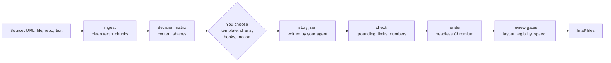

<div align="center">

# explainer-studio

**Turn any article, docs page, repository or notes into scroll-stopping visuals, grounded in the source.**

Ranked GIF diagrams · chart carousels · narrated Reels with designed covers · verified walkthrough videos · LinkedIn posts

[](https://github.com/sarveshtalele/content-creation/actions/workflows/ci.yml)


**[▶ Watch the 50-second demo](docs/media/explainer-studio-demo.mp4)**: the web app, a Reel, a verified walkthrough video and a GIF, all made by explainer-studio

</div>

---

## Contents

1. [What it makes](#what-it-makes)
2. [How it works](#how-it-works)
3. [Requirements](#requirements)
4. [Quick start](#quick-start) (macOS and Windows)
5. [Install](#install): [Claude Code](#claude-code-step-by-step) · [Codex](#codex-step-by-step) · [Antigravity](#antigravity-step-by-step)
6. [Use it](#use-it): [slash commands](#slash-commands) · [Design Studio web app](#design-studio-web-app) · [command line](#command-line)
7. [Update, reinstall, clean, uninstall](#update-reinstall-clean-uninstall)
8. [Quality: checks, evaluations and end-to-end tests](#quality-checks-evaluations-and-end-to-end-tests)
9. [Project structure](#project-structure)
10. [Privacy and security](#privacy-and-security)
11. [Troubleshooting](#troubleshooting)
12. [Documentation](#documentation) · [Contributing](#contributing) · [License](#license)

---

## What it makes

| Media | Output | Highlights |
|---|---|---|
| **GIF** | 1080x1350 looping GIF (under 5 MB) + still PNG | 16 diagram templates (funnel, pipeline, orbit, exploded layers, skyline, conveyor, card grid…) plus an **animated chart** template that turns any of the 21 charts into a GIF, all **ranked for your content**; you choose |
| **Carousel** | PDF + one PNG per slide + first-comment text | 5 cover layouts and over 30 slide types, including **21 chart slides**: lollipop, dumbbell, slope, bullet, radar, sankey, alluvial, network, arc, flowchart, donut, waffle, treemap, sunburst, mind map, decision tree, timeline, Gantt, waterfall, line/area, heatmap |
| **Reel** | 1080x1920 MP4 with offline narration and subtitles | Claude light theme by default, kinetic word-by-word hook, masked scene reveals, camera push, animated counters, particles on connectors |
| **Reel cover** | 1080x1920 PNG per layout + poster JPG | Designed (not a video frame): hero, question, number, split, face; safe for the profile-grid crop and the Reels buttons |
| **Walkthrough video** | 1080x1920 MP4 + E2E report | A real guide run in a browser by **Playwright**: every step is performed, checked (expected vs actual) and shown with a cursor, a highlight and a Verified/Failed badge |
| **Post** | LinkedIn post text | Hook, short points with their sources, your exact closing CTA |

Every frame and slide carries **your brand CTA** (photo, name, tagline) at the bottom. Every word and every number comes from the source: the validator refuses text it cannot find there and data charts refuse invented figures.

## How it works



1. **Ingest** reads the source once and splits it into cited chunks.
2. **The decision matrix** (`data/matrix.json`) scores 19 content shapes, such as narrowing numbers, agent loops, A versus B, hierarchy or trends. It then ranks the GIF templates, carousel charts, Reel motion, hook families, the opening visual and the carousel structure that fit those shapes ([docs/DESIGN_MATRIX.md](docs/DESIGN_MATRIX.md)).
3. **You choose.** The agent shows the ranked options and the [design catalogue](skills/explainer-studio/studio/catalog.html), a page with every design, its ID and a real sample. It asks which design IDs to use and does not build until you answer.
4. **The agent writes one compact `story.json`** from the source. That is the only step that uses the model. Everything else is deterministic code.
5. **Check, render, review.** Text grounding, length limits and number grounding run first. The engine then renders in headless Chromium. Finally, the review gates check layout (overflow, overlap, empty cards), reading time, file size and speech-to-text.

## Requirements

| | Version | macOS | Windows |
|---|---|---|---|
| Python | 3.11 – 3.13 | `brew install python@3.12` | `winget install Python.Python.3.12` |
| Node.js | 20 or newer (with npm) | `brew install node` | `winget install OpenJS.NodeJS.LTS` |
| git | any | `xcode-select --install` | `winget install Git.Git` (also provides `sh` for Reels) |
| ffmpeg | 7 or newer | downloaded by setup | downloaded by setup |
| Disk | about 600 MB | browser, voice model (350 MB) and runtime in `~/.cache/explainer-studio` | same, in `%USERPROFILE%\.cache\explainer-studio` |

Linux works like macOS: install Python, Node.js and git with your package manager.

## Quick start

Four steps, about 5 minutes (most of it is the one-time download in step 3).

<table>
<tr><th>macOS / Linux (Terminal)</th><th>Windows (PowerShell)</th></tr>
<tr><td>

```bash
# 1. get the plugin
git clone https://github.com/sarveshtalele/content-creation.git explainer-studio
cd explainer-studio

# 2. install it for your agents
python3 install.py install

# 3. one-time setup + health check
python3 skills/explainer-studio/scripts/setup.py
python3 skills/explainer-studio/scripts/studio.py doctor

# 4. your brand (shown on every output)
python3 skills/explainer-studio/scripts/studio.py brand \
  --name "Your Name" --tagline "What you post about" \
  --avatar ~/Pictures/me.png
```

</td><td>

```powershell
# 1. get the plugin
git clone https://github.com/sarveshtalele/content-creation.git explainer-studio
cd explainer-studio

# 2. install it for your agents
py -3 install.py install

# 3. one-time setup + health check
py -3 skills\explainer-studio\scripts\setup.py
py -3 skills\explainer-studio\scripts\studio.py doctor

# 4. your brand (shown on every output)
py -3 skills\explainer-studio\scripts\studio.py brand `
  --name "Your Name" --tagline "What you post about" `
  --avatar "$HOME\Pictures\me.png"
```

</td></tr>
</table>

`doctor` prints `READY`, or exactly what is missing. Then open your agent and type `/explainer <a link or some text>`.

No git? Download the latest release zip (`explainer-studio-plugin.zip`), unzip it, open a terminal in that folder and continue from step 2.

## Install

One Python command installs the skill and the slash commands into each agent's own folders:

| Agent | macOS / Linux | Windows |
|---|---|---|
| All three | `python3 install.py install` | `py -3 install.py install` |
| Claude Code only | `python3 install.py install --for claude` | `py -3 install.py install --for claude` |
| Codex only | `python3 install.py install --for codex` | `py -3 install.py install --for codex` |
| Antigravity only | `python3 install.py install --for antigravity` | `py -3 install.py install --for antigravity` |
| Several | `python3 install.py install --for codex,antigravity` | `py -3 install.py install --for codex,antigravity` |

The installer records what it installed, so `update`, `reinstall` and `uninstall` know where to look. `install.py status` shows what is installed and where.

### Claude Code, step by step

1. **Install.** Pick one of the two options.
   - **Plugin (recommended, updates through the marketplace):**
     ```bash
     claude plugin marketplace add /path/to/explainer-studio
     claude plugin install explainer-studio@explainer-studio-marketplace
     ```
   - **Copy:** `python3 install.py install --for claude` (Windows: `py -3 install.py install --for claude`). It writes the skill to `~/.claude/skills/explainer-studio` and the commands to `~/.claude/commands/explainer*.md`.

   Use one option, not both.
2. **Restart Claude Code**, or start a new session.
3. **Check.** Type `/explainer-setup`. The agent runs `doctor` and fixes anything missing.
4. **Use.** Type `/explainer https://example.com/article carousel`. The agent shows the ranked designs and the catalogue, waits for your choice, then builds.

### Codex, step by step

1. **Install:**
   ```bash
   python3 install.py install --for codex          # Windows: py -3 install.py install --for codex
   ```
   - Skill: `~/.agents/skills/explainer-studio` (Windows: `%USERPROFILE%\.agents\skills\explainer-studio`)
   - Commands, as Codex custom prompts: `~/.codex/prompts/explainer*.md`
2. **Optional workspace copy:** a project-level copy in `<project>/.agents/skills` so the whole team gets the skill:
   ```bash
   python3 install.py install --for codex --project ~/work/my-app
   ```
3. **Restart Codex** (CLI or IDE extension) so it reloads skills and prompts.
4. **Check.** In Codex, type `/` and choose `explainer-setup` (newer versions list custom prompts as `/prompts:explainer-setup`).
5. **Use.** Run `/explainer` (or `/prompts:explainer`) followed by a link or some text, then the media you want. You can also just ask: *"Use explainer-studio to make a GIF from this article"*.

### Antigravity, step by step

1. **Install:**
   ```bash
   python3 install.py install --for antigravity    # Windows: py -3 install.py install --for antigravity
   ```
   - Skill: `~/.gemini/config/skills/explainer-studio`
   - Commands, as global workflows: `~/.gemini/antigravity/global_workflows/explainer*.md`
2. **Optional workspace copy:** a copy in `<project>/.agents/skills` that Antigravity reads for that workspace:
   ```bash
   python3 install.py install --for antigravity --project ~/work/my-app
   ```
3. **Restart Antigravity** (or reload the window) so it picks up the skill and workflows.
4. **Check.** In the agent panel, type `/explainer-setup` (workflows appear in the `/` menu).
5. **Use.** Type `/explainer` followed by a link or some text, then the media you want. You can also ask in plain words: *"Use explainer-studio to make a carousel from this page"*.

### ChatGPT (skill only)

Run `python3 install.py zip` (Windows: `py -3 install.py zip`), then upload `dist/explainer-studio-skill.zip` under **Skills > Create > Upload**. In ChatGPT's sandbox, run `python3 scripts/setup.py light`. That mode covers GIFs and carousels; Reels need a local agent.

## Use it

### Slash commands

| Command | What it does |
|---|---|
| `/explainer <url or text> [gif\|carousel\|reel\|cover\|post]` | Ingests the source, shows ranked options, asks you to choose, then builds and reviews |
| `/explainer-walkthrough <site and steps>` | Writes `steps.json`, asks for your OK, runs and verifies the guide, then renders the walkthrough Reel |
| `/explainer-studio` | Opens the Design Studio web app in the background |
| `/explainer-setup` | Runs setup and the health check |
| `/explainer-update` | Pulls the latest version and reinstalls for the same agents |
| `/explainer-clean` | Removes render folders and caches |
| `/explainer-uninstall` | Shows what will be removed, asks, then removes it |

These are the same commands in Claude Code (`/`), Codex prompts and Antigravity workflows.

### Design catalogue

```bash
python3 skills/explainer-studio/scripts/studio.py catalog   # regenerates studio/catalog.html and prints its path
```

The catalogue shows every GIF template, carousel cover and slide (including the 21 charts), Reel cover layout, Reel look and motion, and walkthrough option, each with the ID you give your agent. The Design Studio also serves it at `/catalog`.

### Design Studio web app

Create media by chatting with your agent. Use the web app to check designs against your source, edit content and re-render.


```bash
python3 skills/explainer-studio/scripts/studio.py studio    # prints a private 127.0.0.1 link
```

| Workspace | What you do there |
|---|---|
| **Home** | Paste a source. The decision matrix shows its shapes and the top picks for each media |
| **GIF** | Pick from all 16 templates, ranked with a fit bar and a reason. Choose a hook, then hand the request to your agent |
| **Carousel** | Pick a cover and up to five chart slides (ranked) and edit the content. Builds the PDF and PNGs directly |
| **Reel** | Pick a spoken hook, an opening visual, a format and a look. The matrix shows the motion it chose |
| **Reel cover** | Write a hook and render every layout directly |
| **Walkthrough video** | Build the steps in a form, then run, verify and render. Live progress, the video and the E2E report appear on the page |
| **Post** | Pick a hook and an optional image design |
| **Library** | Everything made on this computer, with previews and downloads |

The app is local only: it listens on 127.0.0.1, uses a random token for each session and refuses requests from other hosts.

### Command line

```bash
S=skills/explainer-studio/scripts
python3 $S/studio.py ingest https://example.com/article --out work
python3 $S/studio.py pick work                       # ranked GIF templates, carousel charts, Reel motion, hooks
python3 $S/studio.py pick work --template funnel     # limits + skeleton for your choice
python3 $S/studio.py hooks work --kind line|carousel|visual|format|structure
# write work/story.json, then:
python3 $S/studio.py check work
python3 $S/studio.py build work --artifacts gif,carousel,reel,post --background
python3 $S/studio.py review work && python3 $S/studio.py finalize work
python3 $S/studio.py cover work --layout hero        # Reel covers without rebuilding the Reel
python3 $S/studio.py walkthrough demo --steps steps.json --device mobile
```

A minimal `steps.json` for a walkthrough:

```json
{"title": "Add your first task", "sub": "Checked in a real browser",
 "steps": [
  {"say": "Open the app", "action": "goto", "url": "https://app.example.com", "expect": {"text": "No tasks yet"}},
  {"say": "Tap New task", "action": "click", "target": "#new", "expect": {"visible": "#title"}},
  {"say": "Type the task", "action": "fill", "target": "#title", "value": "Write release notes"},
  {"say": "Save it", "action": "click", "target": "Add task", "expect": {"text": "Write release notes"}}
 ]}
```

## Update, reinstall, clean, uninstall

| Command | Effect |
|---|---|
| `python3 install.py update` | `git pull --ff-only`, then reinstalls for the same agents. Stops if you have local changes |
| `python3 install.py reinstall` | Removes and installs again for the recorded agents and projects |
| `python3 install.py clean [--jobs] [--dry-run]` | Removes render folders (`.film-*`), caches and `__pycache__`. `--jobs` also removes Design Studio jobs older than 30 days |
| `python3 install.py uninstall [--for codex] [--dry-run]` | Removes the skill copies and commands |
| `python3 install.py uninstall --purge --yes` | Also removes your brand, the library index and the Design Studio jobs |
| `python3 install.py status` | Shows what is installed where, the version and the data folder |
| `python3 install.py zip` | Builds `dist/explainer-studio-plugin.zip` and `dist/explainer-studio-skill.zip` |

## Quality: checks, evaluations and end-to-end tests

| Layer | What runs | Where |
|---|---|---|
| Story check | text grounded in the source, length limits, chart schemas, **every chart figure found in the source** | `studio.py check` |
| Accuracy evaluation | claim support, overlap, recall@3, precision@3, MRR, coverage (lexical proxies) | `out/eval.md` |
| Review gates | 4:5 / 9:16 sizes, GIF under 5 MB, overflow, overlap, empty cards, reading time, animation present, speech-to-text match | `studio.py review` |
| Carousel quality | underfilled, oversized, low-contrast, small-text and soft-image checks | `studio.py e2e` |
| Walkthrough | each step performed and verified by Playwright, with a report (expected, actual, result, time) | `out/*-walkthrough-report.md` |
| Unit tests | content, matrix, platform, security, studio server | `skills/explainer-studio/tests/test_*.py` |
| End-to-end | builds every media, runs every gate and evaluation, drives the web app with Playwright and records a video | `tests/e2e/run_all.py` |

```bash
python3 skills/explainer-studio/tests/e2e/run_all.py              # writes ~/Downloads/explainer-studio-showcase/REPORT.md
```

The showcase folder holds every output (GIFs, carousels and the 21 chart slides, Reel, covers, walkthrough video, post), the review contact sheets, the evaluation reports and `app/app-tour.mp4`, a screen recording of the Playwright tour of the web app.

## Project structure

```
explainer-studio/
├── .claude-plugin/          plugin.json, marketplace.json (Claude Code)
├── .codex-plugin/           plugin.json (Codex)
├── commands/                slash commands, shared by Claude Code, Codex prompts and Antigravity workflows
├── skills/explainer-studio/
│   ├── SKILL.md             what the agent follows
│   ├── scripts/             CLI (studio.py), ingest, matrix, validator, hooks, cover, library, web app server, setup
│   ├── engine/              renderers: GIF templates, carousel + charts.js, reel.js, cover.js, walk.js, walk_run.mjs (Playwright)
│   ├── studio/              Design Studio web app (index.html + js/ modules) and sample thumbnails
│   ├── editor/              per-project story editor
│   ├── data/                matrix.json (decision matrix), hooks.json (hook library)
│   ├── config/  assets/     brand defaults, pronunciation, fonts, default avatar
│   ├── fixtures/            sources used by the tests (including a demo app for walkthroughs)
│   ├── runtime/             Node runtime (Playwright, ffmpeg-static), installed by setup
│   └── tests/               unit tests and tests/e2e (run_all.py, app_tour.mjs)
├── docs/                    architecture, templates, carousel schemas, design matrix, studio, customise, evaluation
├── install.py · install.sh  installer and lifecycle manager
├── .github/                 CI, issue templates, pull request template
└── README.md · CHANGELOG.md · CONTRIBUTING.md · CODE_OF_CONDUCT.md · SECURITY.md · CREDITS.md · LICENSE
```

## Privacy and security

- **Local by default.** Rendering, voice, checks and the web app run on your computer. The network is used only to fetch the sources you give and for the one-time setup downloads.
- **Sources are data.** Instructions found inside an article, repo or web page are never followed.
- **Walkthroughs** run only the steps you write, on `http(s)` pages (and local `file://` pages from the command line). Use test accounts: `"secret": true` blurs typed values in the video and keeps them out of the report.
- **The web app** binds to 127.0.0.1, checks a per-session token on every request, refuses other Host headers and serves only its own files, samples and jobs.

See [SECURITY.md](SECURITY.md) to report a problem.

## Troubleshooting

| Symptom | Fix |
|---|---|
| `doctor` says a part is missing | run `setup.py`, then `doctor` again |
| `python` not found on Windows | use `py -3` |
| Voice install fails on Python 3.14 | install Python 3.12; setup picks it up |
| Browser download blocked by a proxy | set `PLAYWRIGHT_CHROME` to a `chrome-headless-shell` binary |
| A check fails with `not in the source` | use the source's own words and numbers, or a non-data chart |
| A walkthrough step fails | read `out/*-walkthrough-report.md`: it shows the expected and actual result for each step |
| Long Windows paths break the voice engine | keep the folder near the drive root or set `EXPLAINER_HOME` to a short path |

## Documentation

| Document | Topic |
|---|---|
| [ARCHITECTURE.md](docs/ARCHITECTURE.md) | pipeline and components |
| [DESIGN_MATRIX.md](docs/DESIGN_MATRIX.md) | content shapes and how each media is chosen |
| [TEMPLATES.md](docs/TEMPLATES.md) | the GIF templates and their fields |
| [CAROUSEL.md](docs/CAROUSEL.md) | carousel slides, the 21 chart schemas and hook styles |
| [STUDIO.md](docs/STUDIO.md) | the Design Studio web app |
| [CUSTOMIZE.md](docs/CUSTOMIZE.md) | brand CTA, avatar, voice and hooks |
| [EVALUATION.md](docs/EVALUATION.md) | metrics and review gates |
| [AUDIT.md](docs/AUDIT.md) | v3 audit: what was fixed and why |

## Contributing

Read [CONTRIBUTING.md](CONTRIBUTING.md). Before opening a pull request:

```bash
for t in skills/explainer-studio/tests/test_*.py; do python3 "$t"; done
python3 skills/explainer-studio/scripts/selftest.py
python3 skills/explainer-studio/tests/e2e/run_all.py --only gif,carousel,app
```

Ideas, bugs and design requests are welcome: use the [issue templates](https://github.com/sarveshtalele/content-creation/issues/new/choose). Please follow the [code of conduct](CODE_OF_CONDUCT.md), and report security problems privately ([SECURITY.md](SECURITY.md)).

## License

MIT, see [LICENSE](LICENSE). Third-party components and their licences are listed in [CREDITS.md](CREDITS.md).
