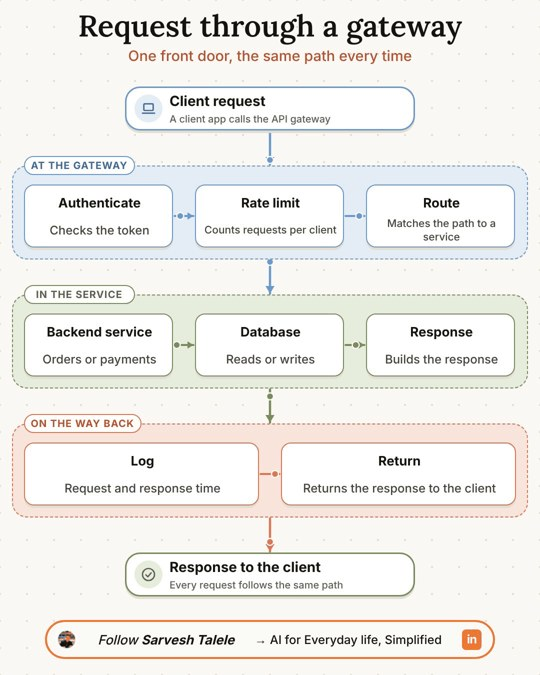
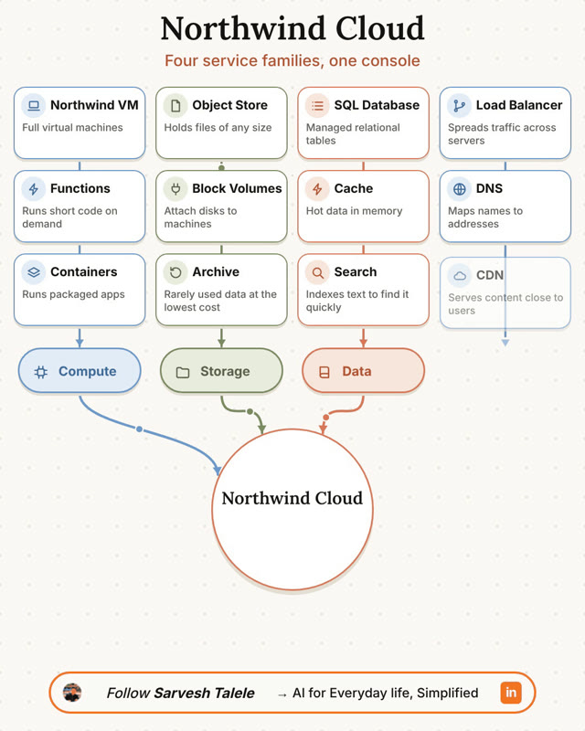
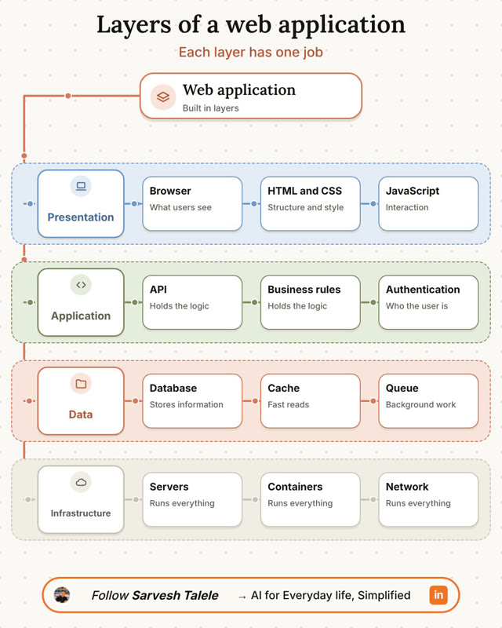
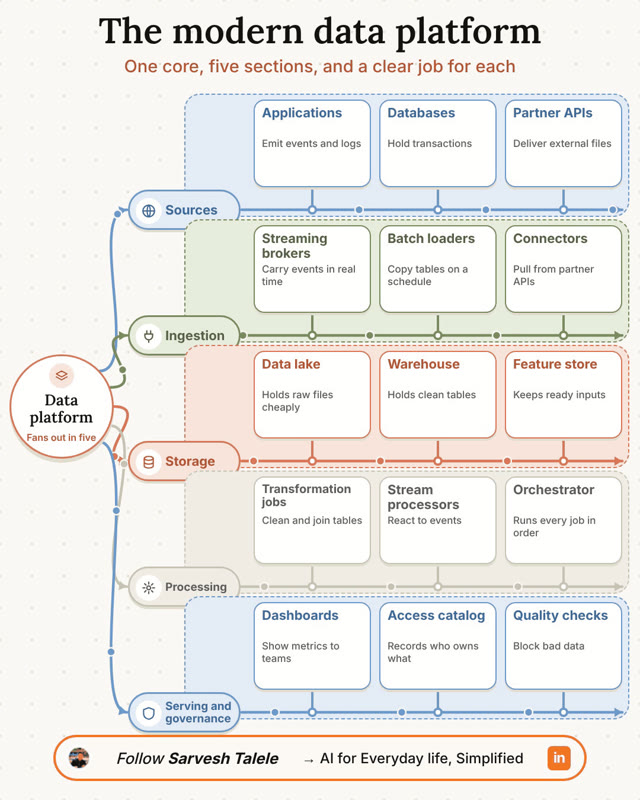
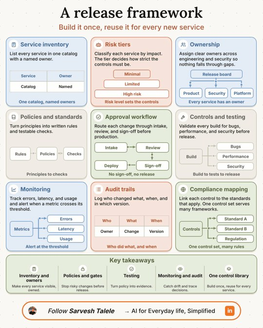
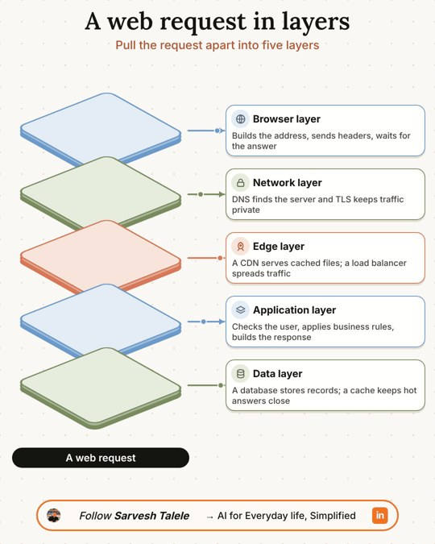
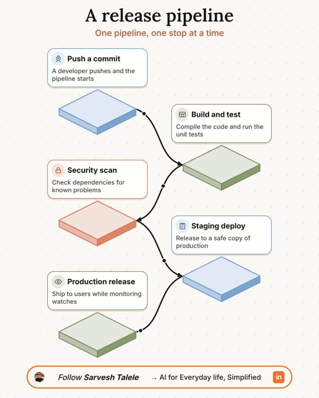
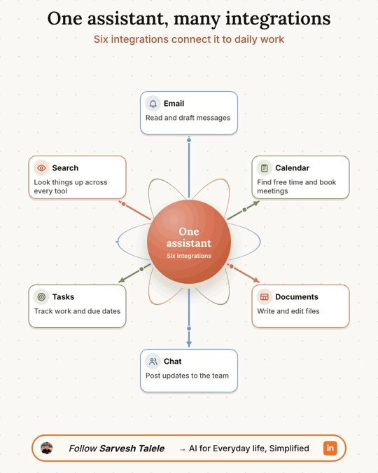
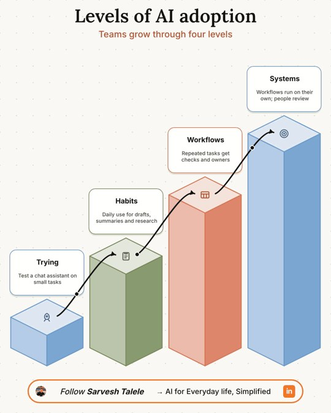
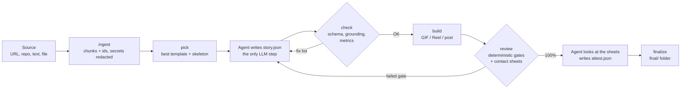

<div align="center">


# explainer-studio

**Paste an article, URL or repo. Get one grounded, on-brand LinkedIn diagram GIF.**<br>
Add a narrated Reel or a LinkedIn post only when you want them.

[Quick start](#quick-start) · [Diagrams](#the-six-diagrams) · [Customise the CTA and hook](docs/CUSTOMIZE.md) · [How it works](#how-it-works) · [Docs](#documentation) · [Contributing](CONTRIBUTING.md)

[](https://github.com/sarveshtalele/content-creation/actions/workflows/ci.yml)
[](CHANGELOG.md)
[](LICENSE)


</div>

---

<details>
<summary><b>Table of contents</b></summary>

- [Why explainer-studio](#why-explainer-studio)
- [Features](#features)
- [Quick start](#quick-start)
- [Install](#install)
- [Use it](#use-it)
- [The ten diagrams](#the-ten-diagrams)
- [Customise the CTA, hook and voice](#customise-the-cta-hook-and-voice)
- [How it works](#how-it-works)
- [Review gate](#review-gate)
- [Security](#security)
- [FAQ](#faq)
- [Documentation](#documentation)
- [Contributing](#contributing)
- [Licence and credits](#licence-and-credits)

</details>

## Why explainer-studio

Turning an article into a clean diagram is slow, and AI-made diagrams are often wrong, cluttered or off-brand. This plugin makes the model do one small job, writing a compact `story.json` from your source, and leaves everything else to deterministic code: choosing the template, checking every claim against the source, laying out text so nothing overflows, rendering, and measuring the result. Same input, same output, every time.

| | |
|---|---|
| **Grounded** | every claim cites a verbatim quote; names and numbers not in the source are rejected |
| **Consistent** | one 1080x1350 LinkedIn portrait format, one palette, one footer, flowing-dot arrows |
| **Token-light** | the model reads the source once and writes only content; checks print only what failed |
| **Gated** | nothing is delivered until every automated gate passes and the contact sheets have been looked at |
| **Yours** | change name, tagline, avatar, CTA and voice with one command |

## Features

- **10 diagram templates**, 6 flat and 4 with 3D motion, picked automatically from the shape of your content
- **Animated GIF** by default, under 5 MB, looping, in your personal brand
- **Narrated Reel** (1080x1920 MP4, offline male voice, 90 seconds or less) on request
- **LinkedIn post** with a hook question, arrow bullets, link and your closing CTA on request
- **Review gate** with Playwright layout checks (overflow, overlap, empty cards) and speech-to-text verification of the voice
- **Safe by default**: SSRF guard, secret redaction, hook-free and symlink-free repo clones, checksummed model downloads
- **Portable**: macOS, Windows and Linux; Claude Code, Codex, Antigravity and Gemini CLI from one skill folder (ChatGPT for the text steps)

## Quick start

```bash
git clone https://github.com/sarveshtalele/content-creation.git && cd content-creation
python3 install.py                                   # Windows: py -3 install.py
python3 skills/explainer-studio/scripts/setup.py     # one time; Windows: py -3 skills\explainer-studio\scripts\setup.py
python3 skills/explainer-studio/scripts/studio.py doctor   # must print READY
```

Then open your agent and say:

> *Create a LinkedIn diagram from https://github.com/owner/repo*

Want your own name, avatar and CTA on it? `studio.py brand --name "You" --tagline "..." --avatar me.png`, see [the guide](docs/CUSTOMIZE.md).

### What you get for each request

You paste an article, essay, URL or GitHub repo. The plugin reads it once, **picks the diagram that fits the shape of the content**, and renders one animated GIF in your personal brand. A male-voice narrated Reel (MP4) and a LinkedIn post are built **only if you ask**.

| You say | You get |
|---|---|
| *"Make a LinkedIn diagram from this"* (or just paste a source) | 1 GIF, 1080x1350, animated |
| *"...and a video"* / *"make a Reel"* | + narrated 1080x1920 MP4, subtitles, poster |
| *"...and a post"* | + LinkedIn post with arrow bullets, link, closing CTA |

Nothing is delivered until every automated gate passes **and** a reviewer has looked at the contact sheets (see [Review gate](#review-gate)).

## Install

Needs `node >= 20` (with npm), `python` 3.11 to 3.13 (what CI tests), `git`. `ffmpeg >= 7` is downloaded for you when missing. Works the same on macOS, Windows and Linux: every step is a Python script, so there are no shell-only commands.

| | macOS / Linux | Windows (PowerShell) |
|---|---|---|
| Get it | `git clone https://github.com/sarveshtalele/content-creation.git && cd content-creation` | `git clone https://github.com/sarveshtalele/content-creation.git; cd content-creation` |
| Copy the skill to your agents | `python3 install.py [project-dir]` | `py -3 install.py [project-dir]` |
| One-time setup | `python3 skills/explainer-studio/scripts/setup.py` | `py -3 skills\explainer-studio\scripts\setup.py` |
| Check | `python3 skills/explainer-studio/scripts/studio.py doctor` | `py -3 skills\explainer-studio\scripts\studio.py doctor` |

`doctor` must print `READY`. `sh install.sh` and `sh .../setup.sh` still work on macOS and Linux as thin wrappers.

| Platform | Where the skill lives | How |
|---|---|---|
| **Claude Code** | `~/.claude/skills/` or as a plugin | `claude plugin marketplace add ./content-creation` then `/plugin install explainer-studio@explainer-studio-marketplace`, or `python3 install.py` |
| **Codex** | `~/.agents/skills/` or `<repo>/.agents/skills/` | `python3 install.py /path/to/project`, restart Codex, say `$explainer-studio` or describe the task |
| **Antigravity** | `~/.gemini/config/skills/`, `<workspace>/.agents/skills/`; CLI: `~/.gemini/antigravity-cli/skills/` | `python3 install.py /path/to/project` |
| **Gemini CLI** | `~/.gemini/skills/` or `~/.agents/skills/`; workspace `.gemini/skills/` | `python3 install.py` or `gemini skills link ./content-creation/skills`; verify with `/skills list` |
| **ChatGPT** | Skills > Create > Upload | `python3 install.py --zip`, upload `explainer-studio-skill.zip` |

### Platform notes

| Topic | macOS | Windows | Linux |
|---|---|---|---|
| GIF and post | supported | supported | supported |
| Reel (narrated MP4) | supported | needs [Git for Windows](https://git-scm.com/download/win) (its `sh.exe` runs the audio mux step; `doctor` shows a `sh (Reel only)` row) | supported |
| Cache folder | `~/.cache/explainer-studio` | `%USERPROFILE%\.cache\explainer-studio` | `~/.cache/explainer-studio` |
| Links to shared node deps | symlink | symlink, else junction, else a copy (no admin rights needed) | symlink |
| Override the cache | `EXPLAINER_HOME=/path` | `$env:EXPLAINER_HOME="D:\es"` | `EXPLAINER_HOME=/path` |

Troubleshooting: `python` not found on Windows, use `py -3`. Voice install fails on Python 3.14, install 3.12 (setup picks it automatically when present). Browser download blocked by a proxy, set `PLAYWRIGHT_CHROME` to a `chrome-headless-shell` binary. Long Windows paths break the offline voice engine, keep the repository close to the drive root or set `EXPLAINER_HOME` to a short path.

**ChatGPT limits.** Its sandbox usually cannot download the browser and voice model. Use it for the grounded story, validation, accuracy report and post; build GIFs and Reels in one of the local agents.

## Use it

Tell your agent what you want and paste the source:

> *Create a LinkedIn diagram from https://github.com/owner/repo*
> *Make a Reel from this article* (male narrator, 90 seconds or less)
> *GIF and post from this essay*

If you give a source and no artifact, you get the GIF. The agent runs the pipeline in [SKILL.md](skills/explainer-studio/SKILL.md). To drive it yourself:

```bash
S=skills/explainer-studio/scripts/studio.py
python3 $S ingest <URL|owner/repo|file|dir|-> --out work     # chunks the source (public hosts only)
python3 $S pick work                                          # best template + limits + skeleton
# write work/story.json (see the skeleton), then:
python3 $S check work                                         # repeat until CHECK OK
python3 $S build work                                         # gif by default; --artifacts reel,gif,post|all
python3 $S review work                                        # gates + contact sheets in work/out/review/
python3 $S finalize work                                      # after attest.json; copies to work/final/
```

Command reference: `doctor | spec [--icons] | ingest | pick | check | eval | post | brand | build | review | finalize`.

## The ten diagrams

The plugin chooses one with `studio.py pick` (a deterministic score over the source's wording and structure). The agent may override with a reason.

| Template | Best for | Preview |
|---|---|---|
| **pipeline** | ordered steps, workflows, request paths |  |
| **columns** | a catalogue grouped by category |  |
| **lanes** | layers of a stack |  |
| **hub** | one concept with named parts |  |
| **ecosystem** | one core fanning out to 3-5 sections |  |
| **framework** | a 6 or 9 part framework, each part a mini-diagram, plus takeaways |  |
| **exploded** (3D) | a thing made of layers, pulled apart |  |
| **isoflow** (3D) | an ordered flow across isometric slabs |  |
| **orbit** (3D) | a core with 4-6 things around it |  |
| **stairs** (3D) | levels or stages that climb |  |

Every template shares the header, palette, flowing-dot arrows (the dots travel along each arrow so the diagram reads as a running workflow) and the "Follow Sarvesh Talele" footer. The Claude spark appears only when the source mentions Claude. Details and how to add your own: [docs/TEMPLATES.md](docs/TEMPLATES.md).

## Customise the CTA, hook and voice

| I want to... | Do this |
|---|---|
| change the **follow pill** (name, "Follow" word, tagline, avatar) | `studio.py brand --name ... --follow ... --tagline ... --avatar me.png` |
| change the **post's closing CTA lines** | `studio.py brand --cta "line one" --cta "line two"` |
| change the **narrator** | `studio.py brand --voice am_onyx --speed 1.0` |
| change the **hook** (GIF title and subtitle, post opening, Reel opening) | edit `work/story.json`, then `studio.py check` |
| **recreate** the GIF, Reel or post | `studio.py build work --artifacts gif` (or `reel`, `post`, `all`), then `review` and `finalize` |

Your brand is stored outside the repo (`~/.cache/explainer-studio/brand.json`), so updates never overwrite it. Full walkthrough with limits, hook-writing tips and agent prompts: **[docs/CUSTOMIZE.md](docs/CUSTOMIZE.md)**.

More customisation:

| I want to... | Edit |
|---|---|
| add a diagram template | [docs/TEMPLATES.md](docs/TEMPLATES.md) (engine file, spec, skeleton, fixture) |
| change colours or fonts | `engine/kit.js` (`C`), `assets/fonts/` |
| change thresholds or limits | `scripts/validate_story.py` (`SPEC`), `scripts/evaluate.py` |

The Reel uses Kokoro (offline, Apache-2.0) with the male voice `am_michael`; `am_onyx`, `bm_george` and others are available. Narration follows a fixed arc: question hook, stakes, answer, how, proof, takeaway, then a question or challenge to the viewer.

## How it works



The model is used for exactly one thing: writing a compact `story.json` from the source. Everything else (ingest, template choice, validation, voice, rendering, measurement, review) is code, so the same input produces the same output.

**Token budget.** The agent reads the source once, runs `pick` (about 250 tokens: template, limits, fill-in skeleton), writes only the content, and sees only failures from `check`/`review`. GIF-only runs skip the narration schema entirely. See [docs/ARCHITECTURE.md](docs/ARCHITECTURE.md).

## Review gate

`review` runs deterministic gates and prints only the ones that fail:

| Area | Gates |
|---|---|
| Story | schema and limits, every claim cited with a verbatim quote, ungrounded names or numbers rejected, accuracy metrics above thresholds |
| GIF | exactly 4:5, size under 5 MB, text legible long enough, nothing overlapping or leaking, arrows animating |
| Reel | 1080x1920, audio present, 90 s or less, loudness -16..-12 LUFS, true peak, speech-to-text matches every script line |
| Post | exact closing CTA lines |

At 100% it writes contact sheets. The reviewer opens them and confirms legibility, no clipping, fidelity to the source and arrow logic in `attest.json`. `finalize` refuses unless gates are 100% and the attestation token matches the current files. Metrics are lexical proxies for faithfulness, not proof of truth; the visual check is a look at stills. See [docs/EVALUATION.md](docs/EVALUATION.md).

## Security

Source text is treated as untrusted data. URLs are fetched from public hosts only, secrets are redacted before anything is written, repo clones run without hooks and symlinks, and downloads are checksum-verified. Details and reporting: [SECURITY.md](SECURITY.md). Contributing: [CONTRIBUTING.md](CONTRIBUTING.md).

## FAQ

**Does it work offline?** Rendering, voice and checks run on your machine. Only fetching a URL or repo, and the one-time setup downloads, need the network.

**Which agents does it work with?** Claude Code, Codex, Antigravity and Gemini CLI run the full pipeline. ChatGPT cannot usually download the browser and voice model, so use it for the story, validation and post, and build GIFs and Reels locally.

**Can I use it on Windows?** Yes. GIF and post work out of the box. The Reel also needs [Git for Windows](https://git-scm.com/download/win) for its audio mux step; `doctor` tells you.

**Is the output guaranteed true?** No. The accuracy metrics are lexical proxies that catch ungrounded names, numbers and claims, not proof of truth, and the visual check is a look at stills. Read the result before you post it.

**How do I change the CTA or recreate a GIF?** See [docs/CUSTOMIZE.md](docs/CUSTOMIZE.md).

**Why a different diagram than I expected?** `studio.py pick work` shows the scores; you can ask the agent to use another template.

## Documentation

| Guide | What is in it |
|---|---|
| [CUSTOMIZE.md](docs/CUSTOMIZE.md) | change the CTA, hook, avatar and voice, then rebuild |
| [TEMPLATES.md](docs/TEMPLATES.md) | every diagram, its fields and limits, how to add one |
| [ARCHITECTURE.md](docs/ARCHITECTURE.md) | pipeline, folders, token budget |
| [EVALUATION.md](docs/EVALUATION.md) | metrics, thresholds, layout checks, what they do not prove |
| [SECURITY.md](SECURITY.md) | threat model, guardrails, reporting |
| [CHANGELOG.md](CHANGELOG.md) | what changed in each version |

## Contributing

Issues and pull requests are welcome. Start with [CONTRIBUTING.md](CONTRIBUTING.md); run the three test scripts below before you open a PR.

```bash
python3 skills/explainer-studio/scripts/selftest.py          # all fixtures: ingest, check, pick, post
python3 skills/explainer-studio/tests/test_security.py       # SSRF, secret redaction, symlinks
python3 skills/explainer-studio/tests/test_platform.py       # Windows/macOS/Linux portability rules (runs in CI on all three)
```

## Licence and credits

MIT, see [LICENSE](LICENSE). Third-party notices: [CREDITS.md](CREDITS.md).

If this saves you time, a star helps others find it.
