# Approval gates: brainstorm, plan, approve, build

Nothing is built until **you** approve the plan, and nothing is delivered until **you** approve the result. This holds in every agent: Claude Code, Codex and Antigravity.

## The workflow

```mermaid
flowchart LR
  S[source] --> I[ingest]
  I --> P[pick and catalog<br/>ranked designs]
  P --> B[brainstorm with you<br/>studio.py plan]
  B --> G[studio.py gate<br/>stamps plan.md with a code]
  G --> A{{you type<br/>approve plan 7f3a}}
  A --> W[story.json]
  W --> C[check]
  C --> R[build]
  R --> V[review<br/>gates and contact sheets]
  V --> F{{you type<br/>approve final 9c1e}}
  F --> Z[finalize<br/>final/ files]
```



1. **Brainstorm.** `studio.py plan W` writes `W/plan.md`. It lists the questions to ask you (audience and next action, design, tone, must-have and must-avoid) and what the source looks like. The agent asks them and fills in the **Agreed with the person** section:
   - the outputs
   - the design IDs
   - the outline: one line per node, panel or slide
   - the logo or icon for each block ([LOGOS.md](LOGOS.md))
   - must-haves and must-avoids
2. **Plan.** `studio.py gate W` adds a line at the end of `plan.md`:
   > To approve this plan, the person types exactly: `approve plan 7f3a`

   The code is the first four characters of the plan's SHA-256 hash. The agent shows you `plan.md` and that line.
3. **You approve.** Type exactly `approve plan 7f3a` (your code) as your whole message. Until then, `studio.py build`, `thumbs` and `cover` refuse to run and exit with code 3.
4. **Build and review.** The agent writes `story.json`, runs `check`, `build` and `review`, and looks at the contact sheets.
5. **You approve the result.** `review` prints `approve final XXXX`, where the code is the start of the review token: the hash of `story.json` and every output file. Look at the files, then type it. Until then, `finalize` refuses to run.

Want changes? Say so instead of approving. The agent edits `plan.md` and runs `gate` again. The code changes with the plan, so an old approval never covers a new plan. The same is true of the result: a rebuild changes the review token.

## Why the agent cannot approve for you

| Protection | How |
|---|---|
| The approval comes from your message | A hook reads the text you submit. It records the approval only when the whole message is exactly `approve plan XXXX` or `approve final XXXX`, and the code matches the current plan or result. |
| The approval is tied to what you saw | The record stores the full hash of `plan.md` (minus its approval line) or the review token. Any later edit, anywhere in the file, invalidates it. |
| The agent cannot write the record | The same hook runs before every tool call and denies any call that touches the approval records: `.gates/`, `gates.approve`, or feeding `gate_hook.py prompt` a fake message. |
| The scripts check too | `studio.py` refuses to build or finalize without a matching record, even where hooks are off. |
| Your clicks count | Clicking build in the Design Studio or the editor is your own action, so those jobs record their approval themselves. |

**Limit:** this is a guardrail, not a sandbox. If every hook is turned off, `studio.py` still refuses to build without an approval record, but it cannot tell who wrote that record. Keep the hooks installed.

## The hooks in each agent

One standard-library script, `skills/content-creation/scripts/gate_hook.py`, serves all three agents:

| Agent | Records your approval | Blocks tampering | Registered in |
|---|---|---|---|
| Claude Code | `UserPromptSubmit` (reads `prompt`) | `PreToolUse` on `Bash\|Write\|Edit\|MultiEdit\|NotebookEdit`, deny via `permissionDecision` | `~/.claude/settings.json`, or the plugin's `hooks/hooks.json` |
| Codex | `UserPromptSubmit` (reads `prompt`) | `PreToolUse` on `Bash\|apply_patch`, deny via `permissionDecision` | `~/.codex/hooks.json` (trust it once in `/hooks`) |
| Antigravity | `PreInvocation` (reads `lastUserInput`) | `PreToolUse` on `run_command`, deny via `{"decision": "deny"}` | `~/.gemini/config/hooks.json`, entry `content-creation-gates` |

```text
gate_hook.py prompt --harness claude|codex|antigravity     records approve plan/final from your message
gate_hook.py tool   --harness claude|codex|antigravity     denies tool calls that touch the approval records
```

A broken payload or an internal error never blocks your session: the hook exits 0 and prints the error to stderr.

Because Antigravity re-sends your last message before every step, the approval code matters there: a stale `approve plan 7f3a` cannot approve a plan the agent has since changed.

## Where the records live

```text
W/plan.md                 the plan, with its approval line
W/.gates/plan.json        {"sha": <plan hash>, "by": "person:claude", "at": "..."}
W/.gates/final.json       {"sha": <review token>, "by": "person:codex", "at": "..."}
~/.cache/content-creation/active.json   the project the next "approve ..." message applies to (set by gate and review)
```

## Commands

| Command | What it does |
|---|---|
| `studio.py plan W` | writes `plan.md`: the questions, the content shapes, the proposed slides (if a carousel) and the **Agreed** section |
| `studio.py gate W` | stamps `plan.md` with its code, makes `W` the active project, and shows both gates (`waiting` or `APPROVED`) |
| `studio.py build W` / `thumbs W` / `cover W` | refused with a `GATE:` line and exit code 3 until the plan is approved |
| `studio.py review W` | prints `approve final XXXX` when every review gate passes |
| `studio.py finalize W` | refused until the result is approved and `attest.json` matches |

## Troubleshooting

| You see | Do this |
|---|---|
| `GATE: no plan.md yet` | the agent skipped planning: ask it to run `studio.py plan`, then `gate` |
| `GATE: plan.md changed since it was approved` | read the new plan; approve the new code it shows |
| You typed the approval but nothing happened | the whole message must be exactly the phrase; in Codex, trust the hooks in `/hooks`; run `python3 install.py status` to check the install |
| `code 1a2b does not match the current plan` | the plan changed after you saw it; ask for `studio.py gate` again |
| A tool call is denied with "approvals are recorded only from the person's own message" | working as intended: the agent tried to touch the approval records |
