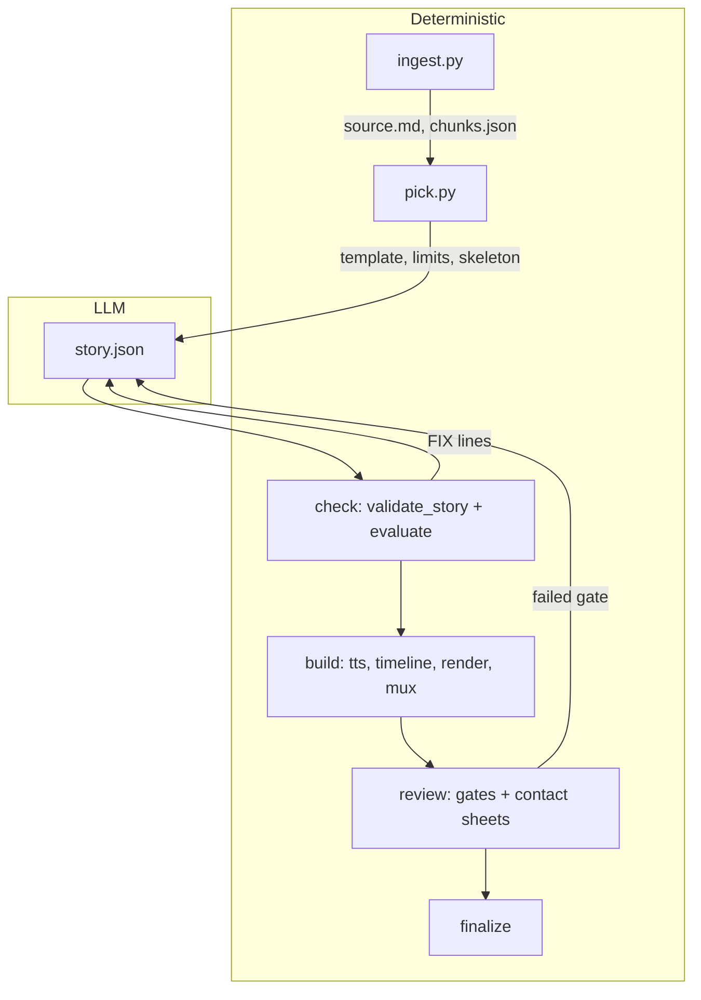

# Architecture

## Principles

1. **One LLM step.** The agent reads the source once and writes `story.json`. Everything else is deterministic code.
2. **Fail with a fix list, not a transcript.** `check` and `review` print only what must change, so repair loops cost few tokens.
3. **Ground everything.** Claims cite chunk ids and verbatim quotes; on-screen text must reuse the source's own words.
4. **Same input, same output.** Fixed layout rules, hashed voice cache, fixed canvas, pinned renderer.
5. **Deliver only reviewed work.** `finalize` is the only path to `final/`.

## Layout

```
skills/explainer-studio/
  SKILL.md              agent instructions (kept short on purpose)
  config/brand.json     name, tagline, avatar, post CTA, voice, speed
  scripts/              orchestration and checks (standard library Python)
    studio.py           CLI: doctor, spec, ingest, pick, check, build, review, finalize
    ingest.py           URL / repo / file -> chunks (SSRF guard, secret redaction)
    pick.py             template choice + fill-in skeletons
    validate_story.py   SPEC (all limits) + validators
    evaluate.py         grounding metrics
    tts_norm.py, timeline.py, mixvoice.py, asr_check.py, post.py
    setup.sh            one-time install of browser, voice model (checksummed), python deps
  engine/               browser-side renderer (plain ES modules)
    kit.js              palette, icons, DOM + animation helpers
    gif_common.js       header, footer, flow arrows (travelling dots), nodes
    gif_<template>.js   one file per diagram template
    reel.js, main.js    Reel scenes and the entry point
  runtime/              bundled render helpers (headless capture, mux); MIT notice in runtime/LICENSE
  fixtures/             one source + story per template (also the regression suite)
  tests/                security tests
```

## Data flow



## The story contract

`story.json` holds only what the requested artifacts need: `meta`, and any of `beats` + `scenes` (Reel), `gif`, `post`. `studio.py spec` prints the authoritative limits; `studio.py pick` prints the limits and a fill-in skeleton for the chosen GIF template only.

## Rendering

The page exposes `render(t)` and `window.DUR`; the capture helper steps time deterministically (no wall-clock), so frames are reproducible. GIFs are palette-optimised ffmpeg output at 1080x1350 (4:5). The Reel is 1080x1920 H.264 with AAC, loudness-normalised to about -14 LUFS.

Arrows are drawn by `flow()` in `gif_common.js`: the path draws itself, then dots travel along it continuously (speed proportional to length). Filled bands get their own svg layer so arrows show above the band and below the nodes.

## Quality loops

| Loop | Trigger | Fix |
|---|---|---|
| check | schema, limits, grounding, metric thresholds | edit story.json |
| layout | text overflow, overlap, leaks, too little reading time | automatic hold-time extension, otherwise edit story.json |
| speech | ASR transcript vs script (Reel) | `tts` respelling or reword |
| review | any failed gate | fix and rebuild |
| attest | reviewer looks at contact sheets | fix and rebuild, never tick unverified items |

## Token efficiency

- Source is chunked once; the agent reads `source.md`, not raw HTML or the repo.
- `pick` prints about 250 tokens (template, limits, skeleton) instead of the whole spec.
- GIF-only runs need no narration, scenes or timing fields.
- Voice output is cached by text+voice+speed hash; reruns do not re-synthesise.
- Validators print failures only.

## Platform notes

The skill is a plain Agent Skills folder, so Claude Code, Codex, Antigravity and Gemini CLI load it the same way. The only per-platform differences are install paths (see README) and the question tool the agent uses to ask which artifact to build.
