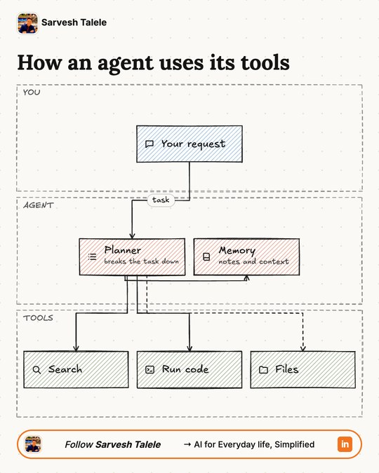
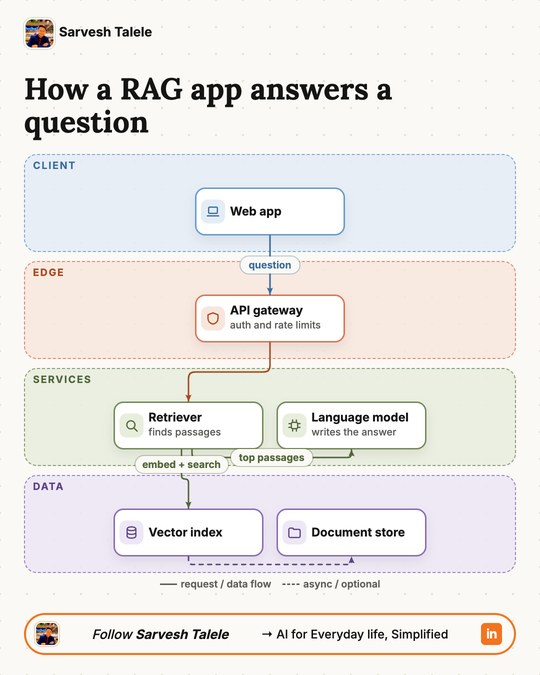
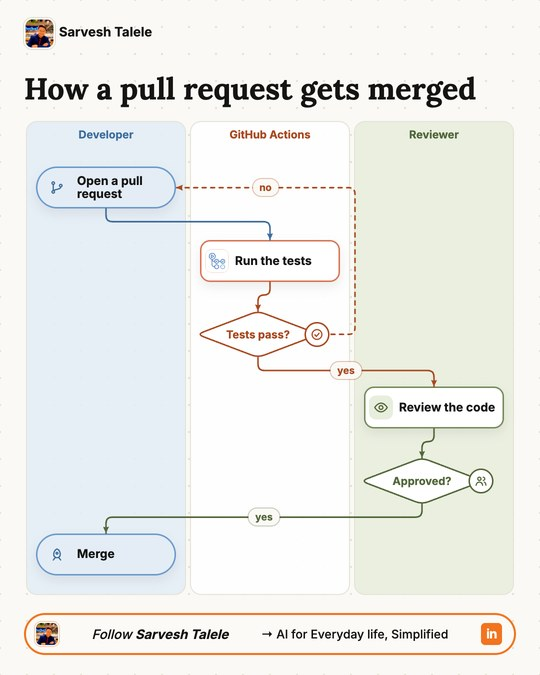
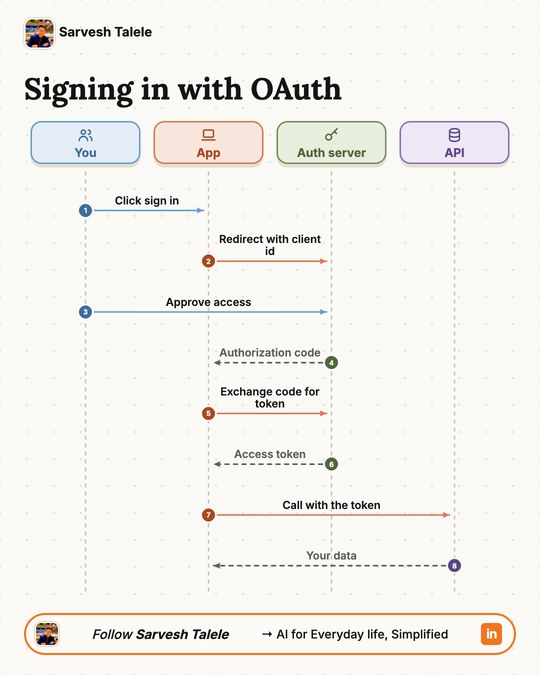
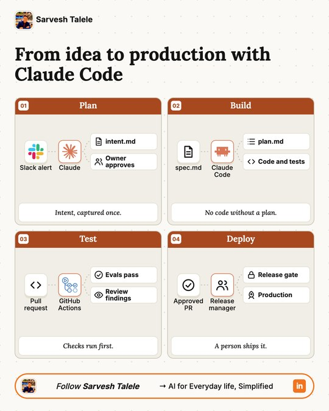

# Architecture diagrams

One diagram for a whole post, article, repository or system, in five styles. The same diagram renders as:
- **GIF** (`gif.template: "arch"`), 1080x1350:
  - the complete diagram is on screen from the first frame
  - only the flow moves: dots run along every connector and the icons come alive step by step, in one seamless loop
- **MP4** (`<slug>-linkedin.mp4`): the same loop as an 18-second video, for posting as native video
- **PNG** (`<slug>-linkedin.png`): the finished diagram as one image
- **Carousel slide** (`type: "arch"` in `carousel.slides`)

| Style | Design ID | Best for | Sample |
|---|---|---|---|
| `sketch` | `arch-sketch` | explaining a system casually: Excalidraw-like strokes, hachure fills, Excalifont |  |
| `cloud` | `arch-cloud` | application and reference architecture: zone bands, service cards, labelled connectors, legend |  |
| `flow` | `arch-flow` | processes, approvals, agent loops: swimlanes, decision diamonds, loop-backs |  |
| `sequence` | `arch-sequence` | protocols and request journeys: who calls whom, in order |  |
| `panels` | `arch-panels` | lifecycles, playbooks, service overviews: numbered stage cards |  |

Every text comes from the source (`check` refuses ungrounded words). Every icon can be an [official logo](LOGOS.md) of a technology the source names.

## Fields

### `sketch` and `cloud`

```json
{ "style": "cloud",
  "zones": [{"title": "Client"}, {"title": "Edge"}, {"title": "Services"}, {"title": "Data"}],
  "nodes": [{"id": "gw", "title": "API Gateway", "sub": "auth and rate limits", "icon": "logo:aws-api-gateway", "zone": 1}],
  "edges": [{"from": "ui", "to": "gw", "label": "question", "dashed": false}] }
```

| Field | Limit |
|---|---|
| `zones` | 1-5, `title` <= 22; read top to bottom (client, edge, services, data) |
| `nodes` | 2-14, `id` <= 16 unique, `title` <= 22, `sub?` <= 36, `icon?`, `zone` index; at most 6 nodes per zone |
| `edges` | 1-18, `from`/`to` two different node ids, `label?` <= 18, `dashed?` |

### `flow` (swimlanes)

```json
{ "style": "flow",
  "lanes": [{"title": "Developer"}, {"title": "GitHub Actions"}, {"title": "Reviewer"}],
  "steps": [{"id": "test", "title": "Run the tests", "lane": 1, "icon": "logo:github-actions"},
            {"id": "ok", "title": "Tests pass?", "lane": 1, "kind": "decision", "icon": "check"}],
  "edges": [{"from": "ok", "to": "open", "label": "no"}] }
```

| Field | Limit |
|---|---|
| `lanes` | 1-4, `title` <= 18; busier lanes get more width |
| `steps` | 3-10, `id`, `title` <= 26, `lane` index, `icon?`, `kind` `step\|decision\|start\|end` |
| `edges?` | 1-16, `label?` <= 12; without edges the steps link in order |

Tips:
- Name the stage in the title, for example "Plan: capture intent.md".
- Put each human approval in its own lane, as a decision. It sits beside the step it judges.
- Label each edge with the artifact it hands on.
- A link back to an earlier step loops on the right, dashed, clear of every block and label.

### `sequence`

| Field | Limit |
|---|---|
| `actors` | 2-5, `title` <= 16, `icon?` |
| `messages` | 2-10, `from`/`to` actor indexes, `text` <= 34, `reply?` (dashed) |

### `panels` (new in 3.4)

```json
{ "style": "panels",
  "panels": [
    {"title": "Build", "input": {"icon": "doc", "label": "spec.md"},
     "core": {"icon": "logo:claude-code", "label": "Claude Code"},
     "outputs": [{"icon": "list", "label": "plan.md"}, {"icon": "code", "label": "Code and tests"}],
     "caption": "Nothing is implemented without an accepted plan."} ] }
```

| Field | Limit |
|---|---|
| `panels` | 2-6, numbered automatically 01, 02, ...; 1 column up to 3 panels, else 2 |
| `title` | <= 18 (serif, in the clay header band) |
| `input`, `core` | `{icon, label <= 18}`; the core tile has a clay border |
| `outputs` | 1-3 `{icon, label <= 20}`, as pills on the right |
| `caption?` | <= 60, italic, under the stage |

As a GIF, the active stage lights up in turn, its icons lift and glow, and dots run along the dashed wires. On a carousel slide, keep to 4 panels with short captions, because a slide holds about 60 words.

## Motion

- Every connector gets travelling dots. The loop length divides every period, so the loop is seamless.
- Icons pop, tilt and glow in workflow order: node order, step order, or input then core per panel. Every icon bobs gently.
- `panels` adds the stage highlight sweep.
- Frame 0 equals the finished still, and the last frame flows into the first. `tests/e2e/run_all.py` checks both.

## From any article, step by step

```text
/content-creation https://example.com/how-our-rag-app-works  architecture diagram
```

1. The agent ingests the source, runs `pick` and shows the ranked designs. You choose a style.
2. It runs `plan`, asks its questions, and writes the outline and the logo or icon per block into `plan.md`. Then it runs `gate` and you type `approve plan XXXX` ([APPROVAL_GATES.md](APPROVAL_GATES.md)).
3. It writes `story.json`, runs `check` (grounding, limits, logos) and `build`, and gets the GIF, MP4 and PNG in `outputs/<slug>/`.
4. It runs `review`, looks at the contact sheet, and you type `approve final XXXX` before `finalize`.

## Layout checks

Every render goes through the layout gates:
- **Overflow:** text larger than its box
- **Overlap:** two cards on top of each other
- **Empty cards**
- **Safe area:** content stays between y 150 and 1216 on the GIF
- **Minimum text size:** 20 px on the GIF

A diagram that fails is not delivered. Shorten the text or split a zone instead.
